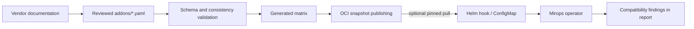

# Mirops compatibility catalog

This repository maintains source-backed Kubernetes add-on compatibility rules and generates the matrix consumed by Mirops upgrade analyses. Each rule maps a conservative add-on version range to the Kubernetes versions supported by cited vendor documentation.



## How the operator consumes the data

The operator uses the compatibility snapshot embedded in its image by default, which supports deterministic and air-gapped operation. An administrator may instead enable the Helm chart’s compatibility-matrix pull and configure a cluster ConfigMap override. This repository’s CI publishes versioned OCI artifacts for that workflow; use a dated tag in production to make results reproducible. The catalog itself does not directly query a running cluster.

## Repository map

| Path | Responsibility |
| --- | --- |
| `addons/` | Human-reviewed YAML rules, one file per add-on. |
| `schema/addon.schema.json` | Schema contract for add-on definitions. |
| `scripts/` | Validation and deterministic matrix generation. |
| `kubernetes/deprecated-apis.yaml` | Generated Kubernetes deprecated-API data; do not edit by hand. |
| `dist/` | Generated output; do not hand-edit. |

## Add or update a rule

```yaml
name: istio
displayName: Istio
source: https://istio.io/latest/docs/releases/supported-releases/
lastVerified: "2026-10"
rules:
  - addonRange: ">=1.30.0"
    k8sRange: ">=1.32.0 <=1.36.0"
```

Use a lowercase kebab-case filename and stable ID, cite the official source that supports the range, and set `lastVerified` to the month the source was checked. Keep ranges conservative: do not infer support boundaries absent from the source. Community-tested rules must be explicitly marked `bestEffort: true` and include evidence, so they remain distinguishable from vendor-confirmed support.

## Validate and inspect generated output

```sh
make validate
make build
```

Validation checks the schema and catalog-wide invariants. Build regenerates the matrix for inspection; publishing is handled by CI. Review the generated diff alongside source changes, and do not commit generated files when repository policy excludes them.

## Responsible contributions

Compatibility data influences production upgrade decisions. Keep changes focused, verify every source, and explain any uncertainty in the pull request. See [CONTRIBUTING.md](CONTRIBUTING.md), [AGENTS.md](AGENTS.md), and the repository’s [Apache-2.0 license](LICENSE).
