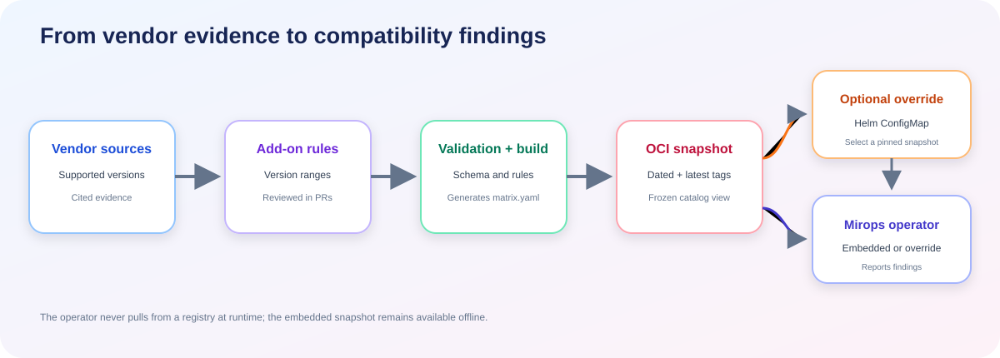
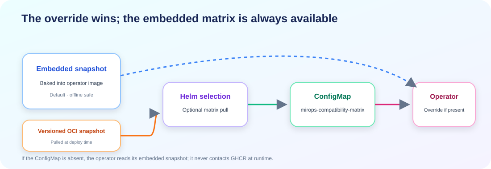
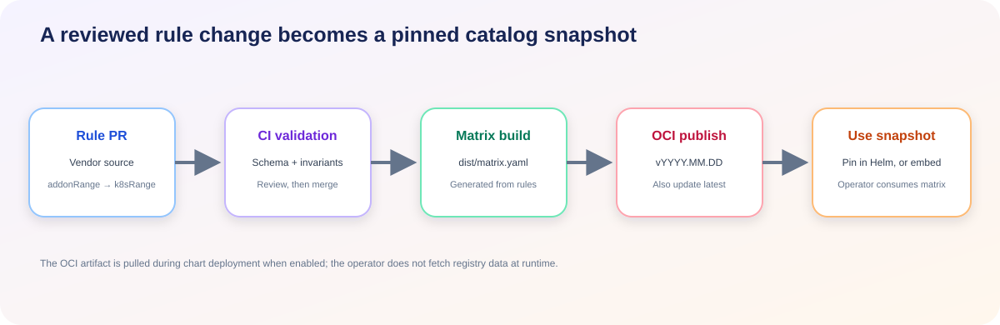

# Mirops compatibility catalog

This repository maintains source-backed Kubernetes add-on compatibility rules used by Mirops upgrade analyses. Each rule maps a conservative add-on version range to Kubernetes versions supported by cited vendor documentation.



The catalog builds a deterministic matrix that can be embedded in the operator image. Administrators may also deploy a dated OCI snapshot through the Helm chart when they need to update compatibility data without building a new operator image.

## Repository layout

| Path | Purpose |
| --- | --- |
| `addons/*.yaml` | Hand-curated, vendor-verified rules; update through pull requests. |
| `kubernetes/deprecated-apis.yaml` | Deprecated and removed API data generated from upstream sources. |
| `schema/addon.schema.json` | Schema applied to add-on rule files. |
| `scripts/` | Catalog-wide checks and matrix generation. |
| `.github/workflows/` | Validation and OCI release automation. |
| `dist/matrix.yaml` | Generated matrix embedded by the operator and published as an OCI artifact. |

## How the operator selects a matrix

The operator uses its embedded snapshot by default. If the `mirops-compatibility-matrix` ConfigMap is present, its data overrides the embedded matrix. The Helm chart can populate that ConfigMap from a pinned OCI snapshot or from administrator-supplied rules.



The operator never contacts a registry at runtime. It can start offline or when GHCR is unavailable; OCI access is only needed when pulling a snapshot during deployment.

Snapshots use UTC date tags (`vYYYY.MM.DD`) and a moving `latest` tag. Pin a date for reproducible upgrade verdicts in production; use `latest` when you want non-production environments to follow the newest catalog.

## Inspect a published snapshot

Compatibility is defined per add-on in [`addons/*.yaml`](addons/) by its `rules:` mapping from `addonRange` to `k8sRange`. Each OCI tag is a frozen snapshot of those rules, merged into `matrix.yaml`. Pull the tag to inspect its contents:

```sh
# A pinned date
oras pull ghcr.io/miropshq/mirops-compat:v2026.08.30 --output ./matrix
cat ./matrix/dist/matrix.yaml

# The moving latest tag
oras pull ghcr.io/miropshq/mirops-compat:latest --output ./matrix
cat ./matrix/dist/matrix.yaml
```

When the override is enabled, inspect the same matrix in the cluster:

```sh
kubectl get configmap mirops-compatibility-matrix -n mirops -o jsonpath='{.data.matrix\\.yaml}'
```

Without that ConfigMap, the operator uses the snapshot embedded in its image, which tracks the operator release rather than a date tag.

## Release flow

A pull request updates source-backed rule files. CI validates the schema and catalog-wide invariants. The release workflow generates `dist/matrix.yaml`, publishes a date-tagged OCI artifact, and updates `latest`. The Helm chart can then pull a pinned snapshot into the override ConfigMap; a later operator release can embed the new matrix.



## Add-on file format

Example from [`addons/istio.yaml`](addons/istio.yaml):

```yaml
name: istio
displayName: Istio
source: https://istio.io/latest/docs/releases/supported-releases/
lastVerified: "2026-06"
rules:
  - addonRange: ">=1.30.0"
    k8sRange: ">=1.32.0 <=1.36.0"
  - addonRange: ">=1.26.0 <1.27.0"
    k8sRange: ">=1.29.0 <=1.33.0"
    bestEffort: true
    evidence: https://example.org/test-report
```

The `source` field should link to official vendor documentation. Mark unverified community-tested rules `bestEffort: true` and include supporting evidence.

## Local checks

```sh
make validate  # validate schema and catalog-wide invariants
make build     # generate dist/matrix.yaml
make clean     # remove generated matrix
```

`make validate` requires Python with PyYAML and the `check-jsonschema` command. It checks filename/name consistency, unique IDs, verification-date format, required metadata, nonempty rules, and non-overlapping add-on ranges.

The catalog covers widely deployed upstream, CNCF, Kubernetes SIG, and major cloud-provider add-ons. Compatibility rows should be based on official project documentation; do not add extrapolated rows without evidence.

## Contributing

See [CONTRIBUTING.md](CONTRIBUTING.md). Every rule must trace to an official source. License: Apache-2.0.
