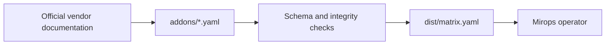

# Mirops compatibility catalog

The source-of-truth catalog for Kubernetes add-on compatibility in Mirops. Each hand-reviewed rule maps an add-on version range to the Kubernetes versions it supports.



## How it is used

The operator can use an embedded snapshot, a cluster ConfigMap override, or a pinned OCI artifact. A pinned artifact makes a result reproducible; the embedded snapshot keeps the operator useful in air-gapped environments.

## Repository layout

| Path | Responsibility |
| --- | --- |
| `addons/` | One reviewed YAML file per add-on. |
| `schema/addon.schema.json` | Per-file validation contract. |
| `scripts/` | Deterministic validation and matrix generation. |
| `kubernetes/deprecated-apis.yaml` | Generated Kubernetes deprecation data; do not edit manually. |
| `dist/` | Generated output; do not hand-edit or commit it. |

## Add or update a rule

```yaml
name: istio
displayName: Istio
source: https://istio.io/latest/docs/releases/supported-releases/
lastVerified: "2026-10"
rules:
  - addonRange: ">=1.30.0"
    k8sRange: ">=1.32.0 <=1.36.0"
```

Use a lowercase kebab-case filename and ID, cite the official source, and keep ranges conservative. Community-tested rules require `bestEffort: true` plus evidence; do not infer a support boundary that the source does not establish.

## Validate locally

```sh
make validate
make build
```

`make validate` checks schema and catalog-wide invariants. `make build` produces the generated matrix for inspection; publishing is handled by CI.

## Contribute with confidence

Compatibility claims affect real upgrade decisions. Keep pull requests focused, verify sources, and review generated output before submission. Read [CONTRIBUTING.md](CONTRIBUTING.md), [AGENTS.md](AGENTS.md), and the Apache-2.0 [LICENSE](LICENSE).

